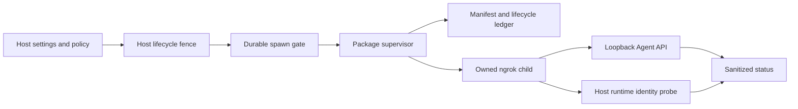

# Laravel Ngrok Server

Safety-first Laravel primitives for an installation-scoped ngrok supervisor. The package owns Agent API observation, process launch and shutdown, durable runtime artifacts, lifecycle recovery, and sanitized status. The host application retains settings, authorization, secrets, database fencing, runtime identity, and realtime integration.

## Requirements

- PHP 8.4 or newer
- Laravel 13
- Symfony Process 7.4.5+ or 8.0.5+
- an `ngrok` executable available through `PATH` or `NGROK_SERVER_BINARY`
- Windows only: PHP `ext-ffi`, used for handle-bound Job Object ownership
- a writable, installation-stable runtime directory

## Installation

```bash
composer require simone-bianco/laravel-ngrok-server
php artisan vendor:publish --tag=ngrok-server-config
```

The service provider is auto-discovered. Publishing configuration is optional unless the host needs to override defaults or command names.

The package deliberately does not own application settings or HTTP routes. Before operating the runtime, bind the eight host contracts documented in [Installation and configuration](z-docs/01-installation-and-configuration.md), then verify the complete operational graph:

```bash
php artisan ngrok-server:doctor
```

## First Run

Bootstrap is explicit and create-once:

```bash
php artisan ngrok-server:ngrok-bootstrap
php artisan ngrok-server:ngrok-supervisor
```

Do not treat bootstrap as a reset command. If durable runtime state is incomplete or uncertain, disable desired state and use the recovery command instead of deleting files or killing processes by PID or image name:

```bash
php artisan ngrok-server:ngrok-recover
```

Request graceful shutdown with:

```bash
php artisan ngrok-server:ngrok-shutdown --reason=operator_request
```

## Safety Model



A spawn requires the installation lock, an initialized manifest, a linked clean lifecycle ledger, an enabled durable spawn gate, current settings, valid remote policy, and healthy upstream identity. Failure is closed: uncertain ownership or inconsistent artifacts require recovery and never authorize a blind replacement spawn.

## Console Behavior

`ngrok-server.supervisor.show_console` defaults to `false`. On Windows the detached launcher uses `php-win.exe` without a new console. Set `NGROK_SERVER_SUPERVISOR_SHOW_CONSOLE=true` only for local diagnostics; this selects `php.exe` with a new console.

## Documentation

- [Installation and configuration](z-docs/01-installation-and-configuration.md)
- [Architecture](z-docs/02-architecture.md)
- [Security and process model](z-docs/03-security-and-process-model.md)
- [Operations and recovery](z-docs/04-operations-and-recovery.md)
- [Testing and troubleshooting](z-docs/05-testing-and-troubleshooting.md)

## License

MIT. See [LICENSE](LICENSE).
