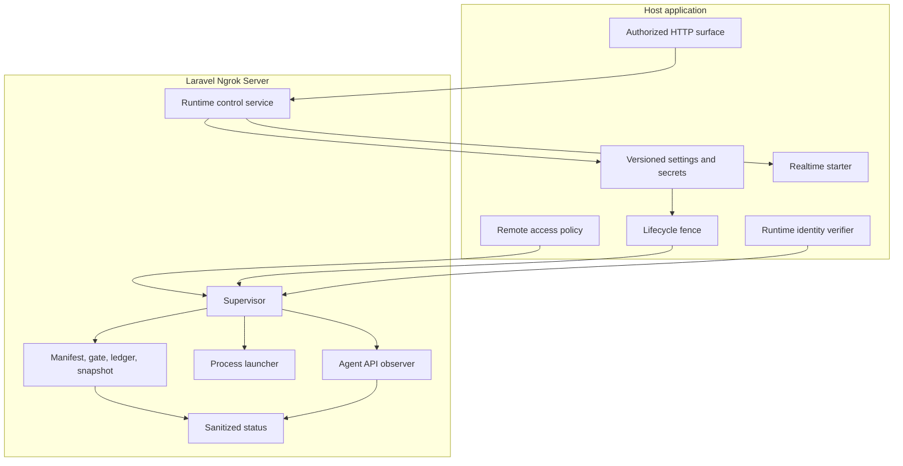
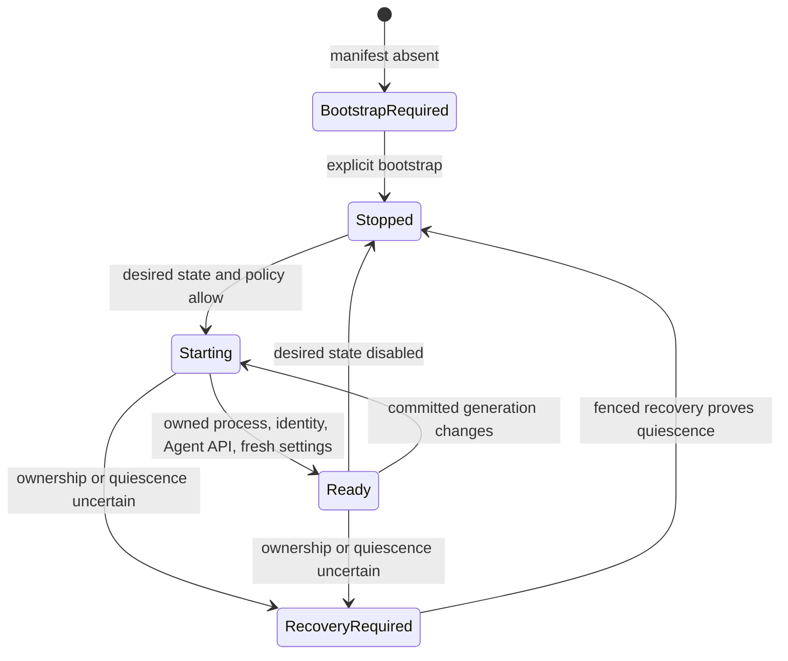

# Architecture

## Ownership Boundary

The package owns reusable ngrok mechanics:

- loopback Agent API client and endpoint observation;
- launch preparation, sanitized environment, owned process start and stop;
- installation lock and durable filesystem artifacts;
- supervisor reconciliation, status projection, bootstrap, shutdown, and recovery;
- generation-bound detached supervisor spawning.

The host owns application authority:

- HTTP routes, authentication, authorization, and Backoffice UX;
- settings persistence, compare-and-swap semantics, and secret decryption;
- the cross-process lifecycle fence;
- remote-access and debug policy;
- upstream runtime identity verification;
- realtime delivery startup and application-specific orchestration.

The package has no dependency on a host `App` namespace or a specific settings implementation.

## Durable Artifacts

Artifacts live below `ngrok-server.runtime_root`:

- a create-once installation manifest;
- a lifecycle ledger linked to that manifest;
- `ngrok-runtime-spawn-gate.json`, either `enabled` or `disabled` with an owner claim;
- sanitized runtime status snapshots;
- shutdown request and acknowledgement files;
- attempt-specific generated ngrok configuration.

The manifest establishes installation identity. The ledger records whether the last handle-bound attempt is clean, active, or uncertain. The spawn gate prevents a supervisor from entering the spawn critical section while bootstrap or recovery crosses process and database boundaries.

## Reconciliation Flow

Ready is an evidence-backed state, not merely a running PID. Publication requires the same committed settings generation, the exact owned process attempt, a healthy upstream identity, and a matching loopback Agent API observation.

## Generation Binding

Desired-state mutations return `NgrokDesiredStateMutation`, containing the committed `NgrokSettingsVersion` and whether data changed. Only a changed start wakes a detached supervisor. The spawned waiter receives the committed incarnation and revision; it exits harmlessly if that generation is no longer active. This prevents stale post-commit side effects from reviving an older desired state.
