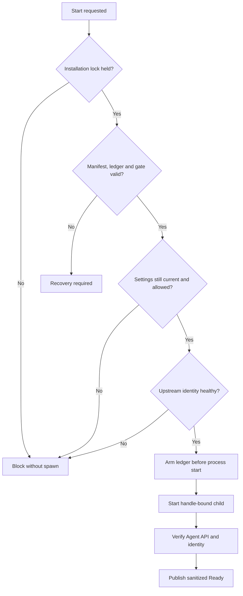

# Security And Process Model

## Fail-Closed Invariants

- A PID, process image name, manifest, or stale snapshot never grants kill authority.
- A new spawn requires an initialized manifest, linked clean ledger, enabled spawn gate, current settings generation, permitted remote policy, and healthy upstream identity.
- Unknown, corrupt, missing, stale, or contradictory ownership evidence blocks launch and requires recovery.
- Ready status requires fresh identity and exact Agent API endpoint evidence.
- Runtime status is sanitized; credentials and process-control authority remain server-side.

## Child Environment And Agent API

The launcher builds a bounded child environment rather than forwarding arbitrary host process state. ngrok inspection and pooling are disabled. The Agent API binds to a selected loopback port and observations must match the exact endpoint prepared for the owned attempt.

Generated ngrok configuration is attempt-specific. It is removed only when the associated lifecycle attempt is proven clean; uncertain state retains evidence for recovery.

## Windows Ownership

Windows uses handle-bound Job Object ownership through PHP FFI. Install and enable `ext-ffi` for the PHP binary that launches the supervisor. `ngrok-server:doctor` fails early if the extension is missing.

The hidden-console default uses `php-win.exe` without creating a new console. `NGROK_SERVER_SUPERVISOR_SHOW_CONSOLE=true` is a local diagnostic override that selects `php.exe` and a new console; it does not weaken ownership or lifecycle checks.

Recovery verifies Job Object ownership and quiescence before cleaning the ledger. A numeric PID alone is insufficient because PIDs can be reused.

## POSIX Ownership

POSIX launch and shutdown remain tied to the package-owned child process handle and attempt evidence. Operators must use package shutdown and recovery surfaces, not broad process-name termination.

## Secret Boundary

The host snapshot provider resolves the ngrok authtoken for server-side launch. Never expose it through HTTP props, browser messages, status snapshots, logs, exception text, generated documentation, or fixtures. The host must also prevent remote operation when debug or policy conditions prohibit access.
