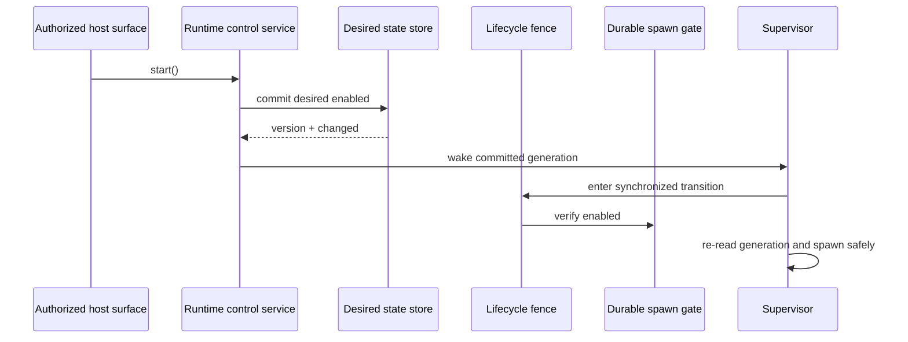
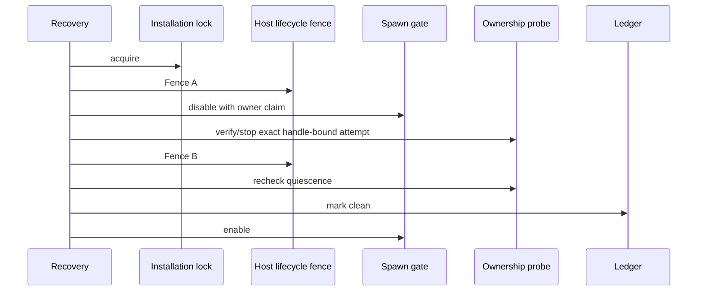

# Operations And Recovery

## Operational Commands

| Command | Purpose |
| --- | --- |
| `ngrok-server:doctor` | Validate Windows FFI when applicable, all host adapters, and operational service construction. |
| `ngrok-server:ngrok-bootstrap` | Create installation runtime identity and initial clean lifecycle artifacts once. |
| `ngrok-server:ngrok-supervisor` | Reconcile desired state and own the ngrok child. |
| `ngrok-server:ngrok-recover` | Recover an interrupted handle-bound attempt only after proving quiescence. |
| `ngrok-server:ngrok-shutdown` | Publish a graceful supervisor shutdown request. |

Hosts can rename these commands through `ngrok-server.commands`. Use `--help` on the configured names for current options.

## Bootstrap

Bootstrap is an explicit installation ceremony, not an idempotent reset. Run it once before starting the supervisor. It acquires the installation lock, disables the durable spawn gate for the transition, creates and links the runtime artifacts, and re-enables the gate only after the lifecycle state is safe.

If bootstrap is interrupted, do not run it repeatedly or delete partial files. Treat the installation as recovery-required.

## Normal Start And Stop

Application code should call `NgrokRuntimeControlService` through an authorized host surface. A desired-state mutation commits first. Only after commit does a changed start wake the generation-bound supervisor or a changed stop publish shutdown. An unchanged mutation causes no duplicate side effect.



For operator shutdown, use:

```bash
php artisan ngrok-server:ngrok-shutdown --reason=operator_request
```

The supervisor stops only its owned child, verifies quiescence, cleans the ledger, and acknowledges the matching shutdown request.

## Recovery

Recovery is required after an interrupted or uncertain lifecycle attempt. Before recovery:

1. disable desired state through the host's authorized control surface;
2. stop launchers that could request a new generation;
3. preserve all runtime artifacts;
4. run the configured recovery command.

```bash
php artisan ngrok-server:ngrok-recover
```

Recovery uses a two-fence protocol:



If the process crashes between fences, the durable gate remains disabled and later starts fail closed. A subsequent recovery reclaims the gate while holding the installation lock. Recovery never converts ambiguous evidence into kill authority.

## Runtime Probe Stability

After startup, one failed upstream/Agent API availability probe does not stop a healthy owned process. Transient availability failures publish `degraded`; recovery inside `runtime_probe_failure_grace_ms` clears the failure streak and returns to Ready without changing PID/spawn attempt. Continuous failure past the grace window triggers the normal owned teardown. Exact identity or Agent API endpoint mismatch remains immediate stop authority.

This policy is intentionally about **continuous elapsed unavailability**, not retry count. CPU starvation can delay both the reconcile loop and HTTP responses; elapsed-time hysteresis makes that distinction observable while preserving fail-closed mismatch handling.

## Status-First Troubleshooting

Inspect the host's sanitized status projection before acting. `bootstrap_required`, `recovery_required`, transition-in-progress, blocked policy, temporary probe degradation, unavailable identity, and Agent API mismatch are distinct conditions. Preserve that distinction in host HTTP responses and operator UX.
