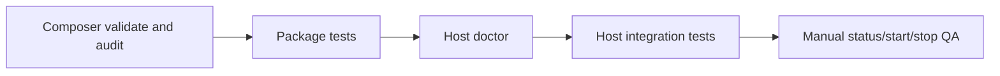

# Testing And Troubleshooting

## Package Gates

From the package directory:

```bash
composer validate --strict
composer audit --locked
composer format:test
composer test
```

Package tests cover the service provider, Agent API, durable files, bootstrap, spawn gate, supervisor safety and generation binding, platform launch behavior, recovery, shutdown, and control side effects.

## Host Integration Gates

After binding host adapters, run the configured doctor command:

```bash
php artisan ngrok-server:doctor
```

The success message confirms that required bindings exist and the principal operational services can be resolved. It does not connect to ngrok, mutate desired state, bootstrap files, or prove application-specific authorization. Host tests must additionally cover:

- settings transaction and compare-and-swap behavior;
- database lifecycle fencing across concurrent workers;
- secret resolution and non-disclosure;
- HTTP authentication, authorization, validation, and conflict mapping;
- realtime startup after committed state changes;
- configured public command names;
- Windows FFI availability in the deployed PHP runtime.



## Troubleshooting

| Symptom | Meaning and safe action |
| --- | --- |
| Doctor lists host interfaces | Bind every listed contract in the host container; do not bind package contracts to no-op placeholders. |
| Doctor reports missing `ext-ffi` on Windows | Enable FFI for the PHP binary used by Artisan and the supervisor, then rerun doctor. |
| `LOCK_HELD` | Another supervisor or lifecycle operation owns the installation. Do not start a second owner. |
| Bootstrap required | Run explicit bootstrap only for a new installation with no prior lifecycle artifacts. |
| Recovery required | Disable desired state, preserve artifacts, and run recovery. |
| Transition in progress | A fenced bootstrap/recovery owns the durable gate. Retry status later; do not bypass the gate. |
| Upstream identity temporarily unavailable | Keep exact owned child during grace; timeout/5xx is not proof of wrong identity. |
| Upstream identity protocol/MAC mismatch | Immediate owned teardown; treat as security/authority failure. |
| Agent API temporarily unavailable | Owned child stays alive and status becomes `degraded` during `runtime_probe_failure_grace_ms`; investigate local CPU/upstream pressure before forcing lifecycle changes. |
| Agent API endpoint mismatch | Immediate owned teardown; verify the selected loopback port and exact endpoint identity, never hide the mismatch behind retry grace. |
| Repeated endpoint offline/restart during CPU load | Compare child PID + ledger `spawn_attempt_id`; a transient probe failure must keep both stable. Run a CPU-heavy existing build as a non-destructive stress probe and verify no attempt/PID rotation. |
| Stale heartbeat | Treat status as stale and investigate supervisor ownership before changing state; stale status alone does not grant kill/restart authority. |

## Prohibited Recovery Shortcuts

Do not:

- delete or hand-edit the manifest, ledger, spawn gate, snapshots, or shutdown artifacts;
- terminate every `ngrok` or PHP process by image name;
- infer ownership from PID alone;
- mark a ledger clean without verified quiescence;
- re-run bootstrap as a reset;
- expose authtokens, runtime identity material, or process-control credentials to a browser.

When evidence remains ambiguous, keep the runtime blocked and retain the artifacts for investigation.
